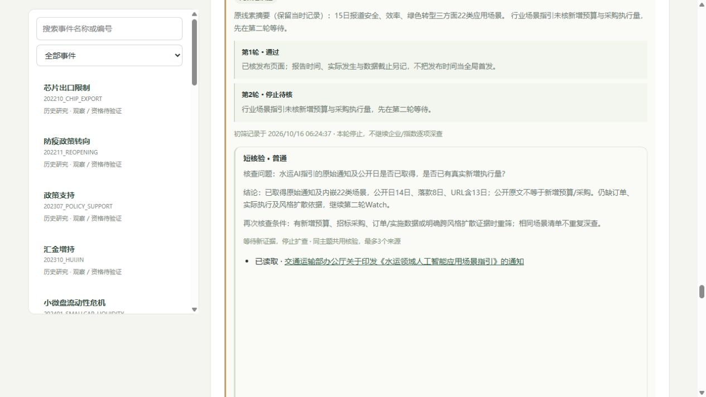

# 政策、监管与科技候选原文核查

本轮从旧批次73条Pending中处理10条，补读11个来源（含1个校方原始发布），全部按实际时刻追加。入库：北京时间2026年10月16日06:24:37，东京07:24:37。原收集窗口仍为北京时间10月14日00:00至15日11:02:05，不宣称完成15—16日新的全量收集。

## 核查结果

| 候选尾号 | 对象 | 实际核查 | 处理 |
|---|---|---|---|
| 0002 | 民营企业座谈会 | 页面日期10月10日 | 旧背景，第一轮停止 |
| 0003 | 新质生产力问答 | 页面日期10月9日 | 旧背景，第一轮停止 |
| 0005 | 服务业发布会介绍 | 页面日期9月29日，实录另链未读 | 旧背景，第一轮停止 |
| 0007 | 9月份发布会介绍 | 页面日期9月22日，实录另链未读 | 旧背景，第一轮停止 |
| 0042 | 公募基金运作规则 | 页面日期10月9日，仍为征求意见 | 旧背景，附件未读，不推定生效 |
| 0051 | 中小企业圆桌会 | 页面日期9月20日，时分存在冲突 | 旧背景，第一轮停止 |
| 0056 | 广交会讲话 | 页面日期10月14日，全文以开放合作和长期战略为主 | 本策略可辨认增量低，第二轮背景 |
| 0239 | 量子网络突破报道 | 15日报道对应校方13日已发布的同一成果 | 重复传播，第一轮背景 |
| 0727 | 水运AI场景指引 | 公开日14日，落款8日，URL含13日 | 第二轮Watch，等执行量与扩散 |
| 0729 | 新能源船舶政策解读 | 可见日期13日，URL含12日 | 旧背景，第一轮停止 |

七条旧背景只核日期、前段或概要即停止，状态Partial；不冒称全文/附件完成研究。它们从发现队列Excluded，但原始来源、日期、指纹及前次Pending版本保留。排除的是“窗口内新增冲击”候选身份，不代表政策失效、新闻永远无价值，也不清零旧Parent或TTL。

另三条已读原文用Linked关联，Linked不等于通过深入门槛。原23个Parent、25份AI判读、19条研究、2条未审核正式因果和0条State保持。

## 两个具体纠错

**技术成果与传播时间分开。** [中国科大近代物理系发布](https://mphy.ustc.edu.cn/2026/1013/c27337a755951/pagem.htm)标注10月13日，技术对象与15日科技日报转载一致，均涉及紫外至通信波段的量子频率转换。同一实验后续传播未见独立新增事实，不作为15日首次技术冲击。校方发布全文已读，论文全文未读，技术纪录/性能属于来源表述，未独立复现实验，也未研究商业订单或指数受益。该原始发布在本轮才取得，不能把知识倒填回13日。

**链接日期、公开日与成文日分开。** [水运AI原始通知](https://xxgk.mot.gov.cn/jigou/syj/202610/t20261013_4225770.html)的URL含13日，政府公开栏目标14日，正文落款8日。原文因此保留窗口内资料身份；“旧日期即归档”不能按URL机械执行。已读通知和内嵌22类场景，仍未取得新增预算、招标采购或实际订单证据。新增一条Watch资料，并对既有报道DC-S-20261015-SHIPAI追加短follow_up，原摘要保留。此主题只有1个补证来源；没有扩展企业和指数完整深查。

## 精确时间不强行补齐

MIIT圆桌会可见17:39与PubDate17:49不一致；商务部讲话可见22:43与PubDate22:46不一致；新浪报道可见08:48与若干发布时间/更新时间字段不一致。保存全部相关元数据与实际读取指纹，published_at暂按核实日期保存，不造零点、精确首发或FirstTradableTime。MakeTime/updated_time不当首次公开时间。日期已核不意味着精确时间已核。

批次报告因此仍有21条精确时间待核（其中可含已核日期）、21条待分流、14类覆盖缺口和8个旧Parent待复核；这些数字未被本轮清零，也不代表本轮读取21条新闻。

## 当前账本与校验

- 原始资料170→181；新增10条简短背景、1条Watch，无新DeepReview。
- 全池最新：5深入 / 29待核 / 80背景 / 67未筛。
- 发现候选：63Pending / 32Linked / 634Excluded，Linked中2条PartialRead，总未解决65（此前75）。
- 本轮10条处理版本：7Excluded、3Linked。旧版本不覆盖；11条资料并非11个新事件。
- 5条深入新闻仍合并3个已判读待证据任务，未新增方向、市场确认或交易许可。

使用现有information、screening、collection与discovery接口，先副本，再主库原子追加。19张表旧行完整保留；8表只追加，另11表内容完全一致。入库前收集/筛选/资格报告相同，整包及两个子包重放无写入，完整性ok、外键违规0。见[data/candidate_read_validation_20261016.json](../data/candidate_read_validation_20261016.json)。

本轮实现代码和数据库结构不变，没有重跑代码测试；此前最近实现基线为184项通过。浏览器已核181资料、29待核、80背景、63待处理与65总缺口，原文/既有报道均在第二轮停止，量子报道与旧监管稿在第一轮停止，控制台无警告/错误。

完整HTML、备份与临时导入脚本保留本机exports；公开仓库只保存短事实、链接、来源指纹和审计元数据。后续继续处理剩余63候选中的宏观、风险、仓位线索；已归档的旧政策和重复科研传播，等新增执行或独立信息再重开。
