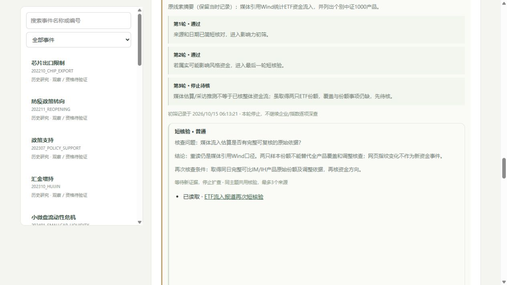

# 待核新闻：短核验、停止条件与再次触发

2026年10月15日06:13按实际知识时刻追加处理。不是今日完整新闻扫描，没有滚动原每日收集截止；没有新增深度AI判读、Parent、正式方向或市场State。

## 本轮结果

原11条Watch处理为2条背景、9条继续待核，另新增1条CPI发布索引线索待核。船舶两条、民航两条、国债两条分别共享主题；共8个主题，其中6个作有限原地址核查，2个未出现新的触发依据而等待。共9个不同原地址，未枚举替代网址或绕过证书错误。

|主题|短核验结果|继续条件|
|---|---|---|
|CPI|[旧日历](https://www.bls.gov/schedule/2026/10_sched.htm)到期，转背景；[正式发布索引](https://www.bls.gov/news.release/archives/cpi_10142026.htm)另入待核，网页和[DOL附件](https://www.dol.gov/newsroom/economicdata/cpi_10142026.pdf)均未取得原件|有可读正式原件和事前预期再重筛；不填写搜索索引数值为已核数据|
|国债|[第65期](https://zwgls.mof.gov.cn/ywgg/202610/t20261013_4002703.htm)正文为单期贴现债发行操作，短归档；附件未读。[第64期](https://zwgls.mof.gov.cn/ywgg/202610/t20261013_4002694.htm)仍受阻|明确新预算、异常净融资或可读原文，不用相邻一期替代|
|ETF|[报道](https://m.cls.cn/detail/2503192)为媒体引用Wind，未补齐完整可比基金原始份额与调整|原始覆盖及份额事项可核，不把网页指纹变化当新增资金事件|
|险资|[采访](https://m.yicai.com/news/103392207.html)观点没有可复核逐日持仓/赎回序列|原始序列和相对暴露；第三轮说明独立针对险资，不套ETF模板|
|综合早报|[页面](https://www.cnfin.com/yw-lb/detail/20261014/4480422_1.html)混合数据、讲话和日程，本轮先独立处理CPI线索|具体重要子项有原始发布出处再拆条核验，不整页升级|
|地方AI|[原地址](https://www.sd.news.cn/20261013/56b9295277054b5f9f79394fd60f97e0/c.html)证书主机名不符，停止|安全可读的原文及重大外溢线索|
|船舶/民航|保留既有第二轮待核，本轮不重复抓取或企业逐项分析|重大执行量、预算、订单或正式范围变化|

来源未取得不等于没有价值。媒体可读也不代表采访推断或资金估算已确认。实际发布线索和旧日程分开，事前预期与前值不混同。

## 工程变化

既有初筛记录新增可选follow_up：前次筛选ID、共享主题、核验优先级、问题、最多3个引用、短结论、再次核查条件和处置结果。使用现有追加账本，不增表；旧包可重放。引用必须已知且有读取状态；Archive需Background且有可读证据，WaitEvidence仍Watch；Rescreen不保证通过。每主题共享最多3个来源，每批最多12个，都是资源预算，不是Alpha阈值。

过时筛选ID、同包重复目标、未来/缺失引用、超量来源或结果与去向不符均拒绝，整批回滚。读不到原文的旧信息仍不能借follow_up绕过深查门槛。工作台显示问题、结论、来源状态与再次核查条件。该流程由当前对话执行，没有后台轮询或定时模型。

当前121条信息、21个Parent、20份AI判读、2条未审核因果更新、0条State。54条最新初筛为2深入/10待核/42背景；67条旧资料未筛。原重点事件仍为1项已判读待证据，不因本轮材料追加反复重做。

## 验证

新增8项短核验测试，全量170项通过；前端语法正常。16张旧表旧行保留、SQLite完整性ok、外键无违规、同包重放不新增。历史06:13:20仍见11条Watch且无新核验说明，当前10条Watch。浏览器验证9张旧待核卡展示跟进说明、新CPI停在第三轮、归档结果保留，控制台无警告/错误。

新增本轮来源包、筛选包、险资说明修订包、报告、验证与截图。原文只留本机，仓库保留短事实、链接及指纹。

