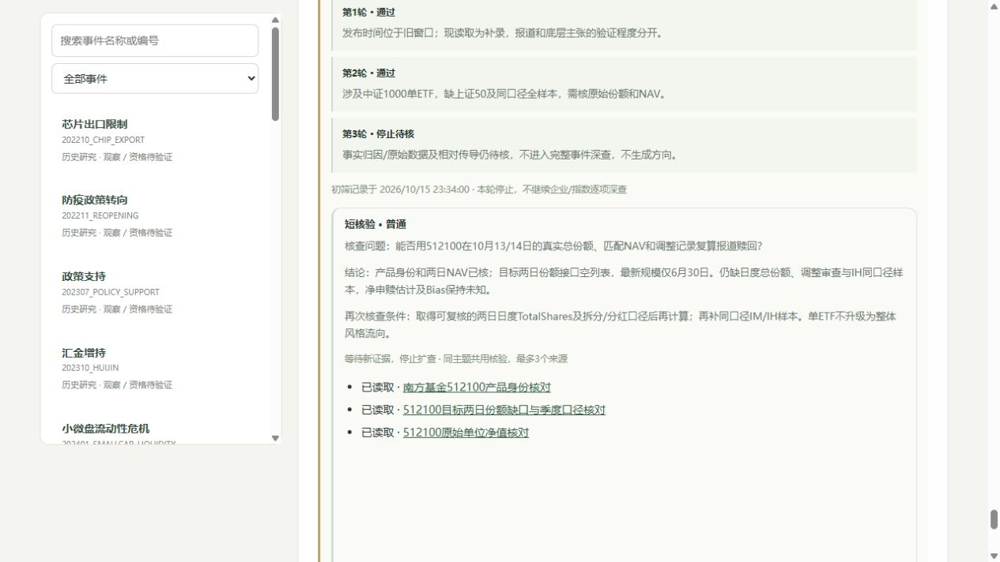

# ETF与航运待核证据核查

本轮只处理两个既有Watch主题，追加6条支持资料/读取日志和3条短核验，未建立新的每日收集窗口。文件日期按东京2026年10月16日，实际入库为北京时间10月15日23:34:00（UTC 15:34:00）。原批次仍为北京时间10月14日00:00至15日11:02:05；本轮发现与入库不倒填到旧截止。

## 1. ETF：关闭身份与NAV缺口，保留份额缺口

核查原报道 `NT-S-20261015-0410`。南方基金产品公开接口确认512100为南方中证1000交易型开放式指数证券投资基金，跟踪中证1000。通过官网实际使用的只读接口查询，未登录、执行交易或运行站点脚本。

| 核查对象 | 实际结果 | 可作何用 |
|---|---|---|
| 2026-10-13单位净值 | 2.8556 | 匹配日期的UnitNAV证据 |
| 2026-10-14单位净值 | 2.8074 | 匹配日期的UnitNAV证据 |
| 10月13—14日历史规模查询 | 成功响应，total=0、list为空 | 本次查询无目标行，不能记为零份额或零申赎 |
| 不限定日期的历史规模首行 | 2026-06-30、3,077,217,646份 | 季度口径，不能替代10月日度TotalShares |
| 日度份额变化/净申赎估计 | null | 缺两日TotalShares及调整审查，未调用计算器制造输入 |

对应[官网产品页](https://www.nffund.com/new/personal-financing/detail.html?fundCode=512100)。动态HTML表格为空后，读取其公开客户端代码定位实际接口；页面壳和脚本只作技术导航，不作为市场证据。

保存3个官方证据来源：`/nfwebApi/fund/overreview`、`/nfwebApi/fund/assetSize`、`/nfwebApi/fund/newValueList`。它们通过POST查询，不是可直接点击即复现同一数据的静态文章。请求方法、参数、查询时间、响应SHA256及取值范围完整记录在[data/watch_evidence_readings_20261016.json](../data/watch_evidence_readings_20261016.json)。NAV响应行fundCode为空，产品绑定明确来自fundCode=512100的请求和同站产品身份查询，没有声称行内自带代码。

不把PCF最小申赎单位、申购上限、季度份额或场内成交额当日度总份额。不把单只ETF当中证1000整体资金，更没有上证50同口径样本。报道赎回金额尚未独立复算，Bias保持null。再次触发：取得真实两日日度总份额、拆分/分红等口径核查，并补同口径IM/IH产品覆盖。

## 2. 航运：读取失败保留，不将空目录当否定证据

核查 `NT-S-20261015-0399` 的货船报道，以及 `NT-S-20261015-0174` 的霍尔木兹通行表态。共享三个UKMTO入口：[近期事件](https://www.ukmto.org/recent-incidents)、[警报](https://www.ukmto.org/ukmto-products/warnings)、[周报](https://www.ukmto.org/ukmto-products/weekly-reports)。直接请求均403，未取得具体事件通报，保存状态为Unavailable，无正文指纹。

网页解析只显示目录或空列表，未能按日期、位置、船名/对象、编号及最新更新核对。空索引不能证明没有袭击，403也不能证明海峡开放或关闭。两船沉没与实际运输影响仍未独立确认。双方通行表态分开保留，不将伊朗—霍尔木兹主题自动并入旧沙特—也门Parent。

两条新闻仍Watch，Bias=null。再次触发：出现可读取的具体日期/地点/编号通报、船东公告或港口/通行实测，再核状态与实际运力；没有新文档或恢复信号时不重复抓取受阻目录。

## 3. 保存与验证

每主题3来源、共6来源，在单批12来源预算内。技术壳页、PCF入口和公开客户端脚本的定位过程不计为可支持市场结论的新增证据。6条资料均简短背景归档；3条原新闻追加follow_up，保留原摘要、原筛选、原记录时点。

当前共170条资料；最新筛选5深入/28待核/70背景/67未筛。Parent仍23，AI判读25，研究记录19，正式因果2条未审核、State0；未新增方向或交易许可。发现账本仍73Pending/29Linked/627Excluded，Linked含2部分读取，未解决75条。支持资料不冒称6条新市场新闻，也不计入旧批次原有收集项。

先副本导入，再主库原子追加。19张表的旧行均保留，仅information_inbox、information_screenings、news_screening_runs和legacy_audit增加记录；其他15张表完全一致。入库前时点的收集/初筛/资格报告一致，整包与筛选子包重放无写入，完整性ok、外键违规0。见[data/watch_evidence_validation_20261016.json](../data/watch_evidence_validation_20261016.json)。

本轮未修改实现代码或表结构，未重跑代码测试；此前最近实现里程碑为184项通过。工作台恢复后已核170条、28待核、70背景及三条新短核验，控制台无警告/错误。页面凭据：

原始HTTP响应、完整技术脚本和副本备份保存在本机exports，不提交公开仓库。仓库保留短事实、公共请求参数、指纹与验证结果，不含响应Cookie。后续优先处理剩余候选的新原文；上述受阻目录等待明确新触发，避免消耗在无变化的重复读取上。
