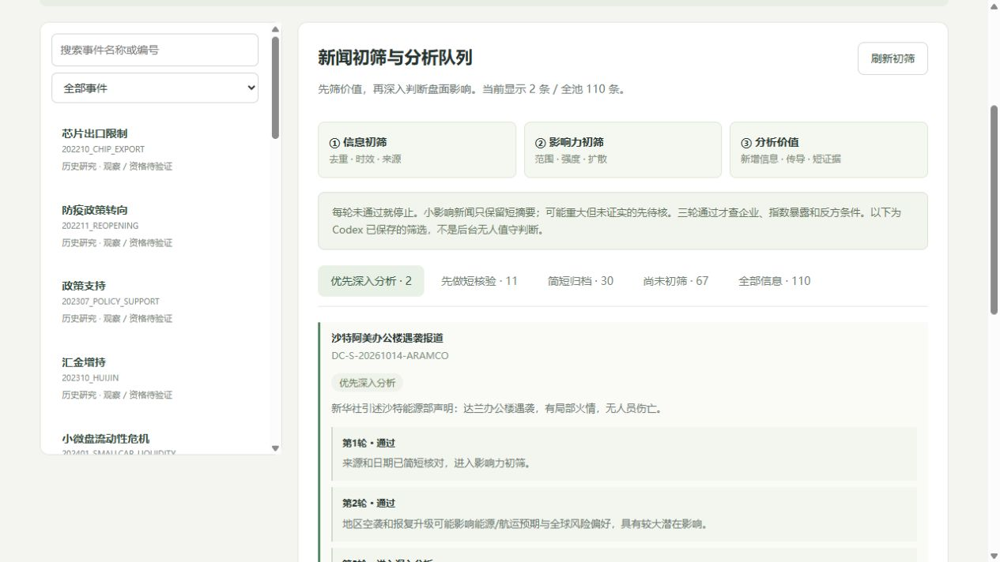

# 新闻分轮筛选：先筛价值，再判断盘面影响

用户要求落实为三轮短初筛。获取的信息先入池，低价值新闻不做整套企业、政策及指数分析；可能重要但未证实的仅做短核验，不误当没有价值。

## 执行标准

| 轮次 | 检查内容 | 通过标准 | 停止去向 |
|---|---|---|---|
| 1 信息初筛 | 重复、时效、来源 | 非重复、当前或待核时间线索，明确可信来源 | 旧背景/重复归档；未来日程、未知来源或传闻待核 |
| 2 影响力初筛 | 范围、潜在强度、扩散 | 至少中等潜在影响，涉及市场/风格，或产业/企业有清晰扩散 | 小影响或无扩散的局部事项归档；可能重要但不清楚的待核 |
| 3 分析价值 | 初步增量、初步传导、短原文支持 | 新事实或更新，清晰传导，基本事实和日期口径有支持 | 重复或无传导归档；增量、传导、支持不足或日期未知待核 |

第一轮仅核信息卫生，不要求精确全局首发；日期未知可继续轻量影响初筛，低影响则止于第二轮。第三轮时间口径仍未知时继续待核。通过不是已证明IM/IH受益，更不等于Formal Bias或开仓信号。单公司事件若能影响重要产业链可以通过，不按公司大小机械排除。

每轮理由最多240字；前轮停止时不填后轮。通过三轮之后，才深入核旧政策与预期、企业机会及成本、两指数净暴露、反方、周期和失效条件。不设必须选满数量，不用一个评分阈值假装已有统计校准。

## 本轮实际结果

上一批29条新闻：2条深入、10条待核、17条简短归档。两条深入项为同一地区冲突链的空袭与报复相关报道，已经归并同一Parent，不算两个独立事件。只是值得核实际影响，未增加方向或市场确认。

内河新能源船舶、民航登记草案和地方AI计划保留待核：潜在影响主要限于细分产业/地方，尚未见风格级大增量或清晰扩散，不继续为这些主题扩大企业逐项深查。政策重述、日常央行操作、旧草案新报道、应用访谈、例行统计等简短归档。

用户补充要求前，已取得14份旧政策、业务和ETF数据材料，本次只短归档：13份背景、1份受阻草案待核。总计43条筛选为2深入、11待核、30背景。旧库67条未重筛，显示“尚未初筛”，不自动判无价值，也不将历史资料全塞进今天深查队列。

全库现在110条信息、21个事件、19条AI判读、19条研究记录、2条未完成审核因果更新、0条市场State。此前深入研究观点保留为历史版本；本轮没有为低优先级主题继续追加AI长分析。初筛记录在2026-10-14 12:35实际写入，不能倒填为早晨已知。

## 已取得材料的简短归档

[2022船舶意见](https://www.miit.gov.cn/zwgk/zcwj/wjfb/yj/art/2022/art_bee1cae3eb6d4efcaf48ad13cd08fb3b.html)与[2024设备更新](https://xxgk.mot.gov.cn/jigou/zhghs/202406/t20240607_4142138.html)已有动力、设施及支持工具，补贴[旧细则](https://xxgk.mot.gov.cn/jigou/zhghs/202408/t20240802_4145816.html)有适用资格；当前不将新标题直接视为新增财政预算。相关正文/附件未完成全量对照，初筛待核不改变原事件正式状态。

ETF数据已经按[上交所原产品页面](https://www.sse.com.cn/assortment/fund/list/etfinfo/basic/index.shtml?FUNDID=512100)实际查询字段核对：TOT_VOL是万份，NAV归清单前交易日；申赎单位与赎回上限不是总份额。10月9日至12日，两个产品的未调整总份额变化为512100 +1.82亿份、510050 -270万份。拆分/合并等事项和整体产品覆盖未核，名义金额估算仍null，也不当作现金入金、全指数资金流或风格Bias。可复核原始响应地址、字段和指纹在数据文件内。

企业与基金披露只保留已有业务和6月末观察，不将样本持仓当作10月事件日权重，不把业务关联当政策新增订单或净利润。这些材料不因已经下载而自动获得深入分析资格。

## 工程交付与限制

新增`event_engine/news_screening.py`、`information_screenings`和`news_screening_runs`只追加表、CLI受信导入/报告、只读API与工作台“新闻初筛”。默认显示通过项，待核、背景、未筛选和全池均可查看；无需用户填写判断。原信息、研究、收集流程保留。

首次启用筛选后，新CurrentReview深度AI判读须引用至少一条与事件关联且通过三轮的信息。无关重大新闻不能借来通过小新闻门槛；历史研究不强制套当前初筛，旧AI包重放仍幂等。普通JSON作者标签不认证作者、读取或推理真伪，导入入口仅供受信本地研究流程。HTTP没有初筛写入或后台模型调用。

新增`fund_flow.py`作为原始份额证据工具：核产品、统计日、单位、字段、可知时刻和净值日期；缺份额事项核查时只显示未调整变化。即使输出名义申赎估算，也不是实际现金流，始终无Bias/交易许可。

数据：`news_screening_20261014.json`、`news_screening_report_20261014.json`、`evidence_brief_sources_20261014.json`、`fund_share_evidence_20261014.json`及验证文件。原始网页/PDF/完整PCF留在本机导出目录，仓库只保留短事实、响应元数据、字段与指纹。

155项测试通过，覆盖各轮停止、后轮不填、单企业重大扩散、未知待核、重筛时序、事务回滚、旧包兼容和深查门槛；份额测试覆盖单位、拆分、非有限数、跨产品、净值日期和未来可知时间。旧行、外键及正式状态隔离另核，工作台截图随交付保存。

