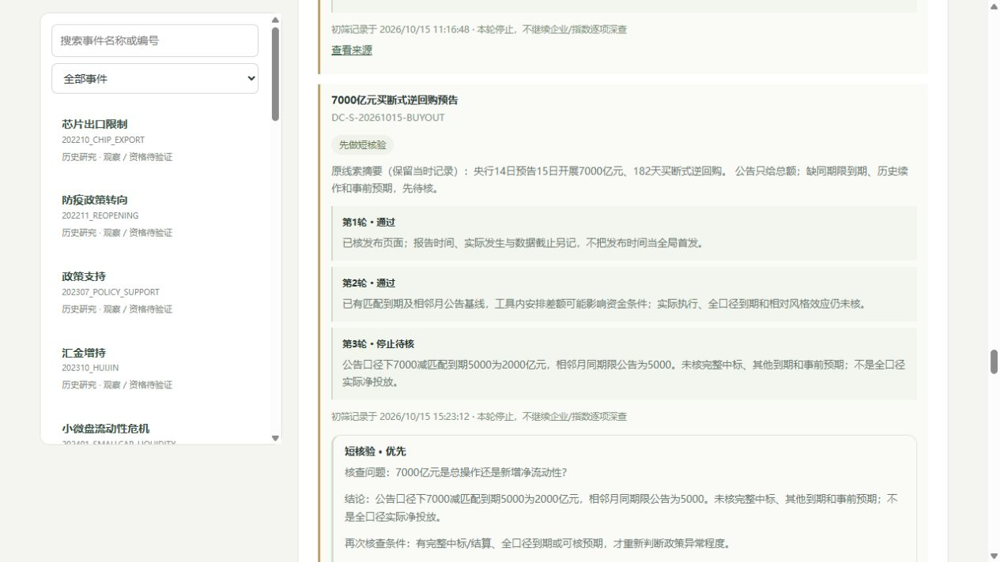

# 新闻补证结果：从标题走到可核依据

2026年10月15日15:21追加证据与褐皮书V2，15:23追加摘要说明修订。本轮只补3个主题，原每日收集窗口仍截止11:02:05，**不是新的全窗口扫描或实时判断**。

## 已解决和保留的问题

|主题|本轮补齐|当前停止位置|
|---|---|---|
|买断式逆回购|[4月第8号](https://www.pbc.gov.cn/zhengcehuobisi/125207/125213/125431/5492845/2026041416545098236/index.html)安排5000亿元于10月15日到期；[9月第18号](https://www.pbc.gov.cn/zhengcehuobisi/125207/125213/125431/5492845/2026091416410185399/index.html)同期限公告为5000亿元。与[10月第20号](https://www.pbc.gov.cn/zhengcehuobisi/125207/125213/125431/5492845/2026101416522429536/index.html)7000亿元公告相减，对应安排差额2000亿元|这是公告安排的对应差额；实际中标/结算、全部到期和其他工具均未核，不称实际全口径净投放。没有事前预期，不填Surprise；继续第三轮Watch|
|褐皮书|[明确标注9月2日的联储银行摘要](https://www.minneapolisfed.org/beige-book-reports/2026/2026-09-su)与[10月摘要](https://www.federalreserve.gov/monetarypolicy/beigebook202610-summary.htm)作对照，调查分别截至8月24日和10月5日|旧摘要缺口部分关闭；仍缺事前预期、相对其他统计的独立增量及两指数净暴露，不定方向|
|光模块/PCB限制解读|政府公报PDF31—34页、印刷57798—57801页中的FCC26-50规则已核文本与图像；规则有清单实体、组件和认证条件|完整FCC命令附件403，公报只读对应四页；不能替代PCB采购、法案和337调查核验，也不能证明不存在其他限制。当前外溢只见行业线索，停止在第二轮Watch|

逆回购每主题只引用3个公告，FCC主题引用2份文件（1部分取得、1受阻）；短核验共5个不同引用，低于原预算。没有把未知当无价值，也没有为了产出方向扩大企业研究。

## 褐皮书比较与来源冲突

两份已核摘要描述中，价格增长强劲地区从1个变为3个；报告较前期价格增速加快的地区从1个变为4个。活动增长地区在旧摘要为10个，本期按分类2+3+4合计9个。这些是未按规模加权的定性调查分类，调查窗口和联系人构成未核一致，不能换算GDP/通胀幅度，也不是一致预期或市场已定价程度。

因旧版文字对照已有可核变化，V2标记Medium研究信息增量；这不等于中等交易Alpha。Surprise、相对Impact和数值方向Confidence仍null。海外贴现率压力可能影响成长，制造业、出口及能源成本又可能产生相反作用；缺净暴露不能直接给IH或IM。上一版观点与知识时点保留。

[联储目录](https://www.federalreserve.gov/monetarypolicy/publications/beige-book-default.htm)标注9月2日的HTML链接实际指向`beigebook202608-summary.htm`，该页标题August、页尾September02，身份标识冲突保存为Partial，不自行改URL或给它补造发布日期。比较基线采用明确标注日期的联储银行摘要；该冲突仍等待官方澄清。本期只重读全国活动、就业、价格及截止说明，不声称重读12地区独立全文。

## 规则读取边界

[政府公报原件](https://www.govinfo.gov/content/pkg/FR-2026-09-11/pdf/FR-2026-09-11.pdf)共有243页，本轮读取并渲染第31—34页，定位对应FCC规则起止，不把相邻海岸警卫队或交通部文件内容混入。公报记载规则10月13日生效；这是9月已公开规则的执行日期，不重建“10月15日首次发布”的新事件。

核到的组件限制与清单实体及设备认证条件相关，不足以推出“所有中国光模块全面禁止”。对已授权设备、待审申请的豁免及变更条件须结合原文，不能只说“全部存量无影响”。完整命令及其他措施仍未核，尚未开展企业适用或收入暴露分析。FCC原附件读取失败后不再重试；公报为另一份发布材料，不能把它标成完整附件已读。

## 工作台与数据

新增6条为旧基线、规则页、身份冲突及读取日志，短归档为证据用途，不计算为6条新市场新闻。2条Watch追加问题、发现、证据与再次触发条件，1项通过事件追加研究V2。界面原线索摘要保持原版本，补证结论另列；已补到期基线从当前第二轮缺口移除，旧轮次仍可查。

当前150条信息、23个Parent、24份AI判读、19条研究记录；正式因果仍2条未审核，State仍0。最新初筛为5深入、23待核、55背景、67未筛；5条通过新闻仍归3个已判读待证据任务，不新增开仓资格。原14类覆盖缺口、日期级发布时间及未复核Parent没有因补证自动关闭。

本轮仅数据和文档变化，未增加表、实现代码、联网采集/模型服务或定时任务。先副本试导入，再同事务写主库；16张旧表旧行完整保留，SQLite完整性ok、外键无违规，研究/筛选及摘要修订包原样重放无新增；入库前时点看不到新来源和V2。页面核对150条信息、24份判读、褐皮书新缺口及两条跟进，无控制台警告/错误。最近代码基线170项测试通过，本轮没有重复运行并宣称新测试结果。

可复查包与快照：

- `data/news_evidence_research_20261015.json`：6个来源与褐皮书V2。
- `data/news_evidence_screening_20261015.json`、`data/news_evidence_screening_correction_20261015.json`：短核验、材料归档与原摘要保留修订。
- `data/news_evidence_comparisons_20261015.json`：单位、算式、计数及适用范围。
- `data/news_evidence_source_audit_20261015.json`：读取时刻、指纹、受阻与PDF范围。
- `data/news_evidence_report_20261015.json`、`data/news_evidence_validation_20261015.json`：全池快照和验证。

原始网页、PDF、四页渲染图与备份只保留本机`../exports/news_evidence_20261015`，未发布整篇第三方资料。下一步只在实际中标/到期、事前预期、企业适用或两指数净暴露出现新证据时重新判断，不反复读取相同原件。

