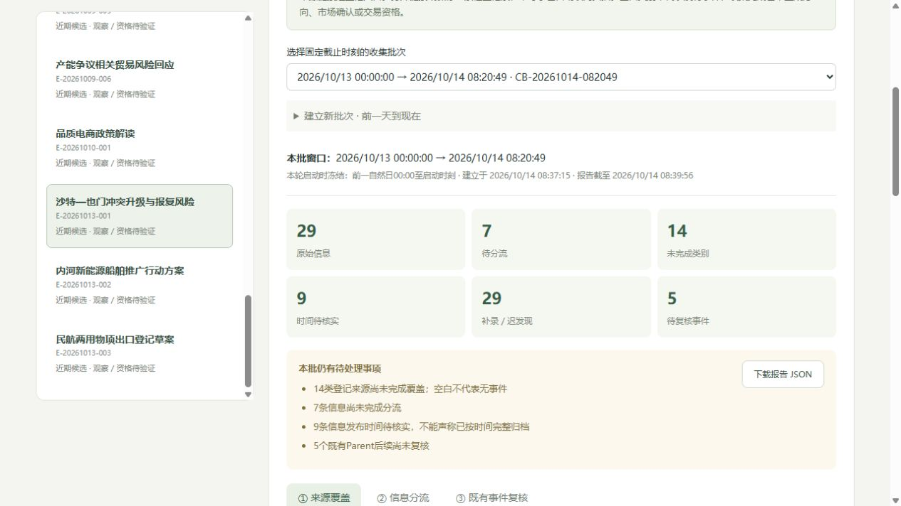

# 每日收集与事件判读

窗口：北京时间2026-10-13 00:00至2026-10-14 08:20:49。实际收集发生在截止后，收集包08:37:15入库，AI意见08:37:16入库。截止时不能提前知道本轮判断。

## 本轮结果

检查冻结登记表的26个入口，针对其中有类别映射的入口保存57项检查，涉及全部14类。补充读取第一财经、BLS及新华社承建金融平台等实际来源，补充来源不冒充冻结入口，也不因此将登记覆盖改成完整。

入库29条信息，包含窗口内发布、旧基线、日程、动态页面观察和待核线索；29不代表29个新增独立事件。新建3个候选、追加5份AI判读，旧数据全部保留。新库共有21个Parent（10近期、11历史）、96条信息、19份AI判读；正式因果更新仍2条，市场State仍0条，正式数值Dominant及研究可评分数量仍为空。

分流：3条新候选、4条事件关联信息、15条背景、7条待核实。按当前严格精确时间口径，19条为窗口内、1条早于窗口、9条时间未知；日期级资料仍展示原日期，不补零点。

### 三个新候选

| 候选 | Codex研究判断 | 主要缺口 |
|---|---|---|
| 沙特—也门冲突升级与报复风险 | 低置信度IH，Fast；仅是风险厌恶的条件假设 | 既有冲突/事前预期、相对Beta/业务暴露、实际供给航运损失 |
| 内河新能源船舶推广行动方案 | 不定方向，Trend | 历史政策对照、可用预算、企业资格与成本、两指数净受益 |
| 民航两用物项出口登记草案 | 不定方向，Trend；草案属性保留 | 草案附件、旧制度独立原文、实际资格与手续净成本、两指数暴露 |

地区冲突来源分别为[13日空袭及报复威胁报道](https://www.news.cn/20261013/fe2580d1b133446c8f4d94aa83e52443/c.html)与[14日办公楼遇袭报道](https://www.news.cn/20261014/8f289993d0c54023a70ca78de6335e4b/c.html)。办公楼局部火情不证明产油设施停产；IH倾向是研究推断，未观察IM/IH行情或核定相对影响幅度。

船舶[官方行动方案](https://xxgk.mot.gov.cn/jigou/syj/202610/t20261012_4225720.html)和[配套报道](https://www.mot.gov.cn/xinwen/jiaotongyaowen/202610/t20261013_4225752.html)归并一个Parent。URL带12日，而页面实际公开日期为13日；报道08:24早于当前原文08:43，不能从当前原文推定全局首次公开。支持工具未核成新增预算。

[民航登记草案解读](https://www.mofcom.gov.cn/xwfb/sjfzrfb/art/2026/art_5fb14edff75c45fa887d5c16d3477eb4.html)说明拟简化部分低风险民用出口手续；不能仅凭“出口管制”字样机械做Risk-off。发行人的旧新对照与独立旧制度原文区分，研究方向保持未知。

### 既有事件与背景

- 新质生产力意见：AI报道重述旧政策与案例，低增量归并；保留V4基线核查和未知方向，参考时间仍为10月9日，未刷新衰减。
- 中欧磋商：[达能会见报道](https://www.mofcom.gov.cn/xwfb/bldhd/art/2026/art_c89c3db56dc54917b700ac5c438f9969.html)发布于13日，会见发生于12日。投资意愿不是新签金额或撤销贸易限制，归并原Parent并保持方向未知。
- 央行[第197号](https://www.pbc.gov.cn/zhengcehuobisi/125207/125213/125431/125475/2026101308450595979/index.html)与[第196号](https://www.pbc.gov.cn/zhengcehuobisi/125207/125213/125431/125475/2026101208533774222/index.html)均为7天1.40%操作；数量变化尚未对到期及预期核验，作为背景，不产生流动性方向事件。196号为窗口外基线。
- ETF报道与险资卖压采访：保留原文、统计期与推测属性，原始ETF份额/持仓和匹配IH数据未取得，继续待核实。
- 银行权益法报道：追溯到9月财政部征意见函索引；10月14日报道不等于新草案当天出台或生效，正文附件未读，不推断银行股新增买入需求。
- [美联储纪要发布说明](https://www.federalreserve.gov/newsevents/pressreleases/monetary20261013a.htm)是历史理事会贴现率会议，区别于新FOMC决议。美东13日14:00 EDT对应北京14日02:00；附件未读。
- [BLS日历](https://www.bls.gov/schedule/2026/10_sched.htm)列CPI北京14日20:30发布，此时晚于截止。保存日程，未填写实际CPI值或惊喜。
- 工博会机器人、东航AI应用和杭州地方优惠是已读报道/自述；未核到独立新增订单、全国预算或指数盈利惊喜，保留为背景。

## 未完成的覆盖与核实

57项检查全部记录为Partial或Blocked，14类均有检查记录，但均未满足完整覆盖。小盘流动性入口受阻；动态公司公告、完整电报、交易所分页、原始ETF份额与机构持仓仍有缺口。不能把未命中当“没有事件”，也不能把目前29条称为全网所有消息。

7条信息继续Pending：国际早报逐条原始来源、两条国债通知正文、ETF净流入、保险卖压、可转债日期冲突、日照计划正文。9条精确发布时间仍未核，包括日期级旧基线和动态页面。其余5个旧候选后续为Pending，已记录检索范围与原因；不是判定事件失效。

本轮全部29条在截止后才发现或归档，报告保留“首次发现晚于截止”。发表时间、事件发生时间、统计期、实际读取和判断入库时间彼此独立。日期级不补零点，不进入精确时刻Alpha。

## 可复核交付与验证

- `data/daily_collection_20261014.json`：29条来源与逐条分流、3个候选、57项检查、7个旧Parent复核。
- `data/daily_source_audit_20261014.json`：实际入口及文章读取状态、时间/元数据与缺口。原始网页正文保留本机导出目录，仓库仅短事实及指纹/链接。
- `data/ai_daily_collection_20261014.json`：5张来源引用、双向传导、政策对照及下一核查动作的研究卡。
- `data/daily_collection_report_20261014.json`：窗口、14类覆盖、信息与复核的报告。
- `data/daily_collection_validation_20261014.json`：14张表旧行逐条保留、数据库完整性、外键及状态隔离验证。

新增本地受信整批导入，失败整体回滚，同包原样重放幂等，改内容拒绝覆盖，入库时刻不接受外部倒填。136项测试全通过，工作台实际核验新数量、固定窗口、覆盖缺口、分流以及保留旧参考时刻。

下一步优先处理原始ETF份额与匹配IH样本、政策旧基线与企业净受益、受阻正文及日期冲突。继续事件解读阶段，暂不开展回测或执行。

