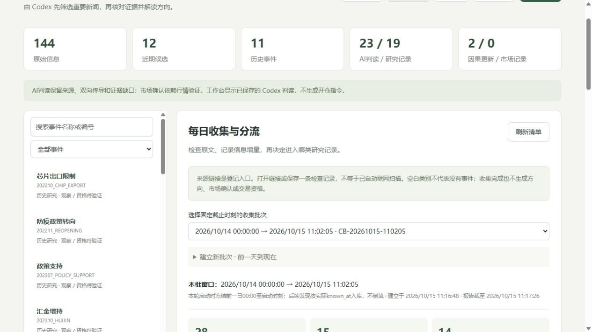

# 10月15日收集与分轮筛选

本轮冻结北京时间 **2026-10-14 00:00:00至2026-10-15 11:02:05**，实际入库11:16:48。截止后读到的历史新闻按实际可知时刻保存，不能回填成开盘前已知。每日收集页可选择 `CB-20261015-110205`；本报告是该批快照，未滚动延长窗口。

## 结果与停止位置

检查26个登记入口，保存14类57项来源检查；23条新资料加5条复用资料，共28条批次成员。新资料筛选结果：

|去向|数量|本轮处理|
|---|---:|---|
|进入研究|3|金融统计、褐皮书摘要、原冲突链后续；完成3份判读，均证据不足而不定方向|
|短待核|13|有潜在影响但缺原件、基线或明确外溢；不展开全套企业与指数深查|
|背景归档|7|例行操作、低影响个案、旧政策转载；停止分析|

5条已有资料跨窗口复用原ID及筛选，不再次入库；其中阿美报道仍归同一冲突Parent。新增2个Draft候选，原冲突追加后续，不为同一报道链重复创建事件。当前144条信息、23个Parent（12近期/11历史）、23份AI判读。全池最新筛选为5深入、23待核、49背景、67未筛；5条深入消息合并3个研究任务，均为“已判读，待证据”。这些不是交易资格或有效信号数量。

## 三项研究判断

|主题与已读来源|为什么值得研究|目前判断与继续条件|
|---|---|---|
|[央行前三季度金融统计](https://www.pbc.gov.cn/goutongjiaoliu/113456/113469/2026101415422529740/index.html)|货币、信用及融资结构可通过现金流与风险溢价影响股票|数据发布不等于新增宽松；同比不等于超预期。先补同口径历史和事前预期，再比较中小企业融资约束与银行息差等双向路径，方向null|
|[美联储10月褐皮书全国摘要](https://www.federalreserve.gov/monetarypolicy/beigebook202610-summary.htm)|增长、就业和成本描述可能影响海外政策预期|材料截至10月5日，摘要不是利率决定；12地区详细报告未读。旧版、预期及两指数相对暴露不足，方向null，不与CPI评论重复计为独立收紧冲击|
|[胡塞称袭击机场的后续报道](https://www.news.cn/world/20261015/66db50dca312495fabe85b74736f654f/c.html)|归原冲突链的新动作，可能影响运输、能源与风险偏好|命中与拦截为不同方面主张，未独立核实停运或产运损失。延续上一版不定方向，不因报道增加恢复IH倾向；旧新闻摘要只作已有输入，本轮未重读|

各卡保留IM受益/受损、IH受益/受损、反方与下一核查条件。没有可核相对幅度，不给Impact分数；没有方向，不用来源可信度填方向数值Confidence。参考时间不新增，不把报道时间当全局首发或交易时间。正式因果更新仍为原2条未审核记录，市场State仍0。

## 短筛的实际作用

常规7天逆回购短归档，总操作金额不能当净投放。[买断式逆回购公告](https://www.pbc.gov.cn/zhengcehuobisi/125207/125213/125431/5492845/2026101416522429536/index.html)待核到期和续作基线，不直接判IM。已读[CPI媒体正文](https://www.cnfin.com/yw-lb/detail/20261014/4480910_1.html)，本地请求中断后通过网页文本读取；没有本地完整HTML指纹，BLS/DOL原件仍未取得，不把二手数据和媒体预期口径升级为正式已核值。

模型开源、火箭发射、固态电池投产和水运AI场景等保留行业线索；没有净利润、执行量和广泛传导依据便停在第二轮。芯片采购“据悉”第一轮待核。光模块/PCB限制梳理区分传闻、拟议法案、认证、采购和调查；原法律文本未核，不能据标题判断全面禁令或限制解除。债券ETF成交额也不等于股票风格净流入。生态环境部14日转载的政策正文电头为9日，识别为旧传播，不刷新旧事件评分。

## 尚未完成的覆盖

所有来源检查均为Partial或Blocked，**本批不是完整穷尽扫描**。首页日期线索每入口最多保留35条，不覆盖所有分页和附件；未逐条读完的发现线索保留在来源审计中，不能算作已筛新闻。政府政策库为动态壳，深交所连接及中金所握手受阻，行情/持仓入口未配置；不关闭TLS核查，不反复试错。

14类仍未达到完整覆盖，9条发布时间只有日期级，15条分流仍待核；10个既有Parent中2个发现新信息，另8个本轮没有完成触发复核，记Pending而非NoChange。旧Watch没有满足新触发条件的不重新展开。每主题3源/批次12源的短核验预算只适用于旧待核补证，不替代26入口的本轮发现范围。

## 核验与可复查文件

先在副本导入核验，再同事务写入本机库。16张旧表全部旧行保留、SQLite完整性ok、外键无违规，3类包重放均无新增；入库前历史时点看不到本批。浏览器核对新窗口、28条成员、来源缺口及3个已判读待证据任务，控制台无警告/错误。本轮未改实现代码或表结构，未重复运行代码测试；上轮代码基线为170项通过。

- `data/daily_collection_20261015.json`：可信本地收集包。
- `data/news_screening_20261015.json`：Codex逐条短筛理由。
- `data/ai_daily_collection_20261015.json`：3份研究卡及输入摘要。
- `data/daily_source_audit_20261015.json`：入口与文章读取、受阻、编码和指纹记录。
- `data/daily_collection_report_20261015.json`、`data/news_screening_report_20261015.json`：批次与全池快照。
- `data/daily_collection_validation_20261015.json`：保留、重放、时点与完整性结果。

原始网页、读取脚本和导入前备份仅在本机 `../exports/daily_collection_20261015`。仓库保留短事实和链接，不发布整篇第三方正文。工作台继续展示已保存结果，没有后台模型、定时任务或实时行情。后续优先补可能改变判断的原始基线和相对暴露，不扩充技术因子。

