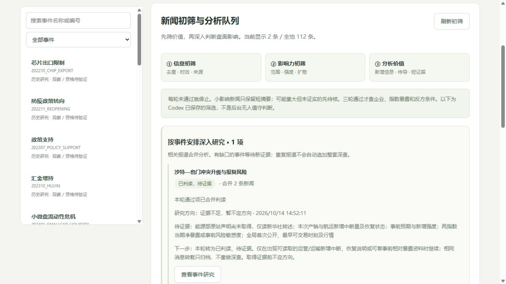

# 初筛后按事件研究，完成后等待新证据

2026年10月14日14:52实际追加一份判读。两条通过新闻归并E-20261013-001，不建立第二个Parent。原08:37低置信度IH观点保留；最新V2撤回该倾向，Bias、Impact及方向数值置信度均为null，不写Neutral。

## 已读取材料与判断

|原文|读取结果与边界|
|---|---|
|[13日空袭报道](https://www.news.cn/20261013/fe2580d1b133446c8f4d94aa83e52443/c.html)|完整读取，指纹与早晨一致；新袭击事实不代表已知减产量|
|[14日办公楼消息](https://www.news.cn/20261014/8f289993d0c54023a70ca78de6335e4b/c.html)|完整读取，指纹一致；能源部声明为新华社转述，未取得能源部原站|
|[9月20日旧冲突](https://www.news.cn/20260920/b2521756522a4827ba2614a6870d0580/c.html)|完整读取，保留各方说法归属；旧风险不等于市场一致预期|
|[9月12日管道报道](https://www.news.cn/world/20260912/48f4c168e43d421c8405215b474e22cf/c.html)|完整读取，报道过预防性关闭；不能认定10月仍关闭|
|[阿美消息入口](https://www.aramco.com/en/news-media/news)|搜索索引可见，直接读取超时；不声称全部公告已检查，不认定生产正常|

Codex推理：风险厌恶可能影响风险敏感资产，但缺事前两指数净暴露和风险敏感度。实际供给或运输受限还可能改变能源收入、成本、信用和需求，不能仅凭RISK_OFF或大小盘标签合并成IH优势。旧基线削弱首次风险冲击的解释，但不证明新增影响为零。于是本轮完成研究并保持方向未知。

两个旧来源作为背景止于第一轮。当前112条信息、21个Parent、20份AI判读、19条研究记录、2条未完成审核因果更新、0条市场State。45条初筛为2深入/11待核/32背景，67条旧资料未筛。通过项对应1任务：0待判读、1已判读待证据。没有对其他11条待核项展开长分析，也未刷新原13日新闻参考时间或收集冻结窗口。

## 工作流与边界

新增只读research_queue投影，不新增任务写入表。唯一可见Parent的通过新闻合并；未归并或多个Parent时提示Codex核归属，不任意选择。最近判读须覆盖当前所有通过项，时间不早于筛选且输入摘要有效，才标本轮完成；有gaps或InsufficientEvidence则已判读待证据。新增通过项、重新初筛或因果输入变化会返回待判读。

旧关联表无建立时间，不能完整重建历史归属；API排除尚不可见Parent，此投影不能用于历史交易证明。来源、筛选、判读、因果仍按真实known_at查询。无正式方向、State或交易许可新增。

后续仅在有可读取的运营/运输新增中断、恢复说明或可靠事前相对暴露资料时继续。重复报道短归档，缺失证据列待核，不反复读取同一入口。

## 验证

新增7项队列测试，全量162项通过，前端语法检查通过。16张旧表旧行完整保留，SQLite完整性ok、外键无违规，同包重放不新增。浏览器验证合并2新闻为1任务、最新不定方向及旧IH历史，控制台无警告/错误。

新增研究包、基线筛选包、事件队列及验证文件。网页全文留本机，仓库保存短事实、URL、读取时刻和指纹。

