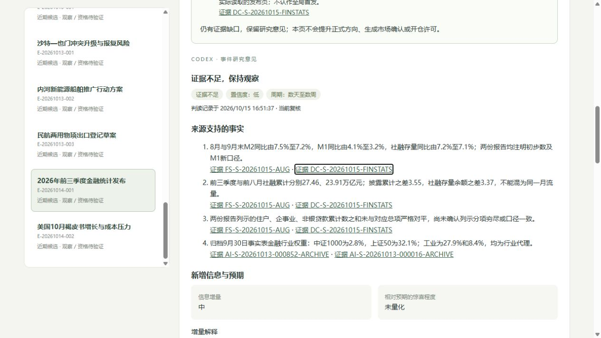

# 金融统计新闻：基线、口径与相对暴露

本轮仅处理已通过初筛的E-20261014-001，2026年10月15日16:51按实际入库时刻追加V2。原每日收集截止11:02:05不变，不声称16:51完成全窗口采集。新增2条为基线/镜像证据，另重读已归档指数行业图，没有新增事件或开仓信号。

## 已完成的证据

[央行8月报告](https://www.pbc.gov.cn/diaochatongjisi/116219/116225/2026091417020862747/index.html)作为较早公开的数据基线；[前三季度原发布页](https://www.pbc.gov.cn/goutongjiaoliu/113456/113469/2026101415422529740/index.html)重读并与[统计司镜像](https://www.pbc.gov.cn/diaochatongjisi/116219/116225/2026101417073743604/index.html)核对，主要数字段落一致。镜像不计独立冲击、不重置评分起点。所有数据按原文“初步数”保存，M1均注明2025年启用的新口径。

16项指标各保存2个期间披露值，按唯一metric_id组织，单独注明单位、部门范围、指标粒度和发布版本。同比增速之间求百分点差，月加权资金利率与政策利率分开；跨发布版本累计数只求披露值差，不能直接填官方单月流量。源值和差值采用字符串Decimal核算，不受二进制浮点误差影响。

|已核对的变化|用途边界|
|---|---|
|M2同比7.5%→7.2%，M1同比4.1%→3.2%，社融存量同比7.2%→7.1%|增速回落不是政策收紧的直接证明；期末余额仍可能增加|
|社融累计23.91→27.46万亿元，披露差3.55；存量464.80→468.17万亿元，余额差3.37|累计流量差与存量余额差不是同一概念，不强行对平；前者跨版本，不能冒称已核官方9月增量|
|住户贷款两期累计披露均为减少1.03万亿元|舍入披露之差为0，不能证明9月实际新增为零；实际单月流量仍null|

所有Surprise保持null；旧实际数据不是市场事前一致预期。没有补历史均值、预期调查或单月数来替代尚未读取的证据。

## 数据质量核查：一个未解的覆盖问题

这是“统计新闻输入是否可比较”的限定配套检查，未另建分析应用或修改事件引擎。主要风险与处置如下：

|问题|证据|风险与处置|
|---|---|---|
|列示部门与总项未对平，覆盖尚未确认（高影响，算术结果确定、原因未知）|前8月总项10.44，列示住户/企事业/非银合计9.7920，相差0.6480万亿元；前三季度总项11.52，列示合计10.9335，相差0.5865|未证实列示部门为穷尽分区，不能判定官方错误、补造缺失部门或计算完整部门贡献|
|跨版本累计及舍入（高影响，已加使用限制）|报告来自9月14日和10月14日两个初步发布版本|修订、覆盖和舍入均未核齐，官方单月流量留null；需同版本月表再核|
|行业快照与企业净暴露不同（中等影响，已限定）|仅重核9月30日行业图，未取得10月14日实时权重及企业资产负债数据|只作代理，不由行业权重直接推方向或收益|

这张残差表是对列示数字的算术核查，不证明数据发布错误，也不确认已经发生修订。来源可能存在部门覆盖或其他口径差异，原因未知。保留原值及缺口，不为满足对平而调整数字。

## IM/IH传导已经具体到哪里

两份已保存的官方事实表仅重核第2页行业图、图例和日期，并核验原文件SHA。9月30日金融行业代理权重：中证1000为2.8%，上证50为32.1%；工业代理权重为27.9%与8.4%。原URL会更新，本轮用已归档版本，没有用今天版本回填。

金融传导对IH的行业暴露更值得先查，但金融包含多个子行业，不是全部银行；贷款量、净息差和信用损失可能互相抵消。IM工业代理较高，但融资资格、订单、资金成本和利润传导未知。两者都不能用权重乘宏观变化当指数收益。样本银行与其他金融拆分、借款企业融资需求及事件日实时权重仍缺。

V2将可核旧数据变化记为Medium研究信息增量，Surprise、Bias、相对Impact和数值方向Confidence仍未知。不因来源A或金融权重较高自动给IH。研究意见不升格正式因果，市场状态与进场许可仍独立。

## 知识库与验证

当前152条信息、25份AI判读、23个Parent（12近期/11历史）、19条研究记录；正式因果仍2条未审核，市场State为0。最新筛选5深入/23待核/57背景/67未筛，5条通过新闻对应3个已判读待证据任务。旧版卡、旧数值和历史时点保留。

先在副本核验，再同事务追加主库；16张旧表全部旧行保留，完整性ok、外键无违规；研究和筛选包重放无新增，入库前时点看不到新来源和V2。计算笔记实际执行并复现16项差值、零差值的未知保护及两期未对平残差。核算通过不表示数据质量缺口已关闭。本轮只改数据/说明和配套计算笔记，没有改实现模块或表结构，没有重跑并声称新的170项代码测试结果。

原工作台服务已停止；后台重启被自动审批策略拒绝，改为受控会话运行仅监听127.0.0.1的服务后完成页面核验。浏览器确认152条信息、25份判读、金融统计V2及旧版、来源范围、未知方向和新缺口，无控制台警告/错误。

可复查文件：

- `data/financial_stats_research_20261015.json`：2条新来源与V2完整输入/引用。
- `data/financial_stats_comparisons_20261015.json`：16项原值、期间、单位、版本、差值含义和质量缺口。
- `data/financial_stats_screening_20261015.json`：基线和镜像的证据归档。
- `data/financial_stats_source_audit_20261015.json`：读取时刻、主文一致性依据及PDF核查范围/指纹。
- `data/financial_stats_report_20261015.json`、`data/financial_stats_validation_20261015.json`：全池和验证快照。
- `notebooks/financial_stats_evidence_20261015.ipynb`：已运行的标准库计算复现笔记。

本轮网页原文、PDF渲染图和备份在本机`../exports/financial_stats_20261015`；既有指数PDF归档不变。下一触发是可核同版本月表、发布前预期或企业净传导依据，不重复读取同两份报告。

